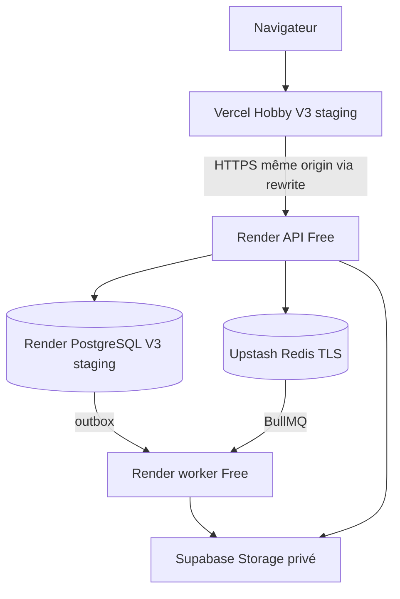

# LOT14 — Architecture du MVP staging certifié

Verdict : **GO STAGING FONCTIONNEL**. Revue finale et merge encore en attente.
Le [rapport final](lot14-certification.md) fait foi pour les preuves, leur source,
les limites et le périmètre. SHA applicatif certifié :
`39f5cc20aa1c429210a6ab18597e218a1b693e88`.

| Composant  | Architecture / état final                                                                                                                                      |
| ---------- | -------------------------------------------------------------------------------------------------------------------------------------------------------------- |
| Web        | Vercel Hobby, projet V3 staging dédié ; https://gestschool-v3-staging.vercel.app ; smoke HTTPS 49/49 acquis.                                                   |
| API        | Render Free Francfort, https://gestschool-v3-api-staging.onrender.com ; état final ok, PostgreSQL/Redis/storage up confirmé.                                   |
| Worker     | Render Web Service Free Francfort, https://gestschool-v3-worker-staging.onrender.com ; état final ok, report E2E completed ; stabilité 21/21 HTTP 200 acquise. |
| PostgreSQL | Render PG18 Free V3 staging ; 14 migrations/checksums vérifiés, verify-full ; temporaire, expiration enregistrée au 23 novembre 2026.                          |
| Redis      | Upstash Free TCP TLS/auth, dépendance critique pour IAM et BullMQ ; workflow réel certifié.                                                                    |
| Storage    | Supabase Free projet V3 `rwmuksaafbnphurxaofq`, eu-west-1 ; bucket `gestschool-v3-staging-private` privé ; S3 signé et accès anonymes contrôlés.               |
| Messaging  | Brevo configuré ; aucun email réel non autorisé, aucun WhatsApp staging. Tests externes provider à compléter avant usage réel.                                 |

Le navigateur utilise l'origin Vercel et `/api/v1`, cookies Secure/HttpOnly/Strict,
CSRF réel et origins exactes. Le runner interne utilise le vrai HTTP Nest sur
loopback ; il ne remplace pas les smoke navigateur publics.

Le bootstrap a créé deux tenants et huit comptes synthétiques. Les 14 scénarios
A/B passent, puis l'export report traverse outbox/BullMQ/worker/stockage privé.
Les secrets restent dans Render et aucun secret n'est recopié dans les rapports.
Les flags bootstrap/certification sont revenus OFF, sans rejeu après OFF.

La readiness reste fail-closed. PostgreSQL ne retente qu'un CONNECT_TIMEOUT, une
seule fois après 200 ms ; seul SELECT 1 réel donne up. La fenêtre de stabilité
n'a pas exercé ce retry et ne prouve aucune récupération réelle.

## Pourquoi ce GO n'est pas un GO production

Render peut dormir ; PostgreSQL Free est temporaire ; HA, sauvegardes/restauration,
Redis/queues durables, monitoring et charge restent à certifier. CSP unsafe-inline,
contrat bearer Brevo, filtrage Students studentId et autres dettes sont explicités
dans le [rapport](lot14-certification.md#pourquoi-ce-go-nest-pas-un-go-production).
Aucun établissement réel à onboarder. Ces prérequis restent LOT15 Backlog / Not started.

Le premier incident AUTH_UNAVAILABLE demeure sans cause historique démontrée ;
le second run diagnostiqué PASS ne permet pas d'en inventer une.

Le [runbook courant](deployment/staging.md) conserve les commandes et flags OFF.
L'[historique](lot14-staging-history.md) conserve les anciens états sans les
présenter comme le verdict courant. V2 intacte, aucun paiement, merge ni tag GO.
