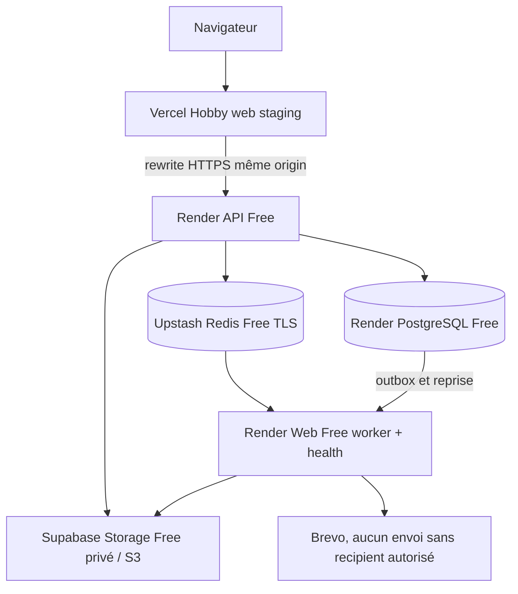

# LOT14 — Architecture de staging entièrement gratuite

Décision du 25 octobre 2026 : **zéro paiement et zéro carte avant validation client**. Cloudflare R2 est abandonné ; Supabase Storage Free est choisi. Les limites gratuites ci-dessous sont acceptées pour staging uniquement. Verdict actuel **NO-GO**, car les tests distants restent à exécuter.

| Composant  | Cible et état réel                                                                                                                                                            |
| ---------- | ----------------------------------------------------------------------------------------------------------------------------------------------------------------------------- |
| Web        | Vercel Hobby `gestschool-v3-staging`, team `protels-projects`, domaine réservé `gestschool-v3-staging.vercel.app`, pas de déploiement certifié                                |
| API        | Render Web Service Free `gestschool-v3-api-staging`, Francfort, `https://gestschool-v3-api-staging.onrender.com`, prérequis applicatifs incomplets                            |
| PostgreSQL | Render Free `dpg-dbei7tqvcj2c73d1qukg-a`, PG 18 à Francfort, disponible selon provider, expiration `2026-11-23T21:32:39Z`                                                     |
| Redis      | Upstash Redis Free dédié ; URL TCP TLS enregistrée dans Render selon le propriétaire, connexion non certifiée                                                                 |
| Worker     | Cible Render **Web Service Free** `gestschool-v3-worker-staging`, même branche, image Chromium + `/health` préparées, service pas encore créé                                 |
| Storage    | Supabase Free `gestschool-v3-staging`, `rwmuksaafbnphurxaofq`, région réelle **eu-west-1** (projet existant réutilisé), bucket `gestschool-v3-staging-private` confirmé privé |
| Brevo      | Compte PROTEL existant, aucun destinataire autorisé et aucun email réel                                                                                                       |

Le navigateur conserve l'origin Vercel pour `/api/v1`, les cookies host-only/Strict, le CSRF et connect-src self. Aucune ouverture wildcard. Les origins doivent rester les deux adresses staging réelles ; aucune mutation V2.

L'adaptateur S3 reste inchangé. Endpoint configuré `https://rwmuksaafbnphurxaofq.storage.supabase.co/storage/v1/s3`, région `eu-west-1`, path-style true. Les deux clés S3 et REDIS_URL ne sont pas lues par l'agent ; elles restent dans Render. Diagnostic temporaire `LOT14_STORAGE_PROBE=true` au build API préparé pour vérifier les quatre opérations S3, checksum/MIME, refus anonymes et suppression, sans clé dans les logs. Le hook doit être publié sur la branche avant toute exécution réelle.

Le worker n'ouvre HTTP que si `WORKER_HTTP_HEALTH_ENABLED=true`, APP_ENV staging et NODE_ENV production ; port Render, 200/503, pas de données métier. L'image inclut Chromium, ses librairies et les fontes du lockfile. Le port est ouvert après les trois runtimes, puis fermé avant arrêt des queues. Pas de serveur health factice indépendant d'un worker prêt.

## Limites acceptées pour staging uniquement

Supabase Free : 1 GB, fichier maximum 50 MB, pause après inactivité, aucune garantie production/HA. Bucket public=false confirmé ; limite bucket null héritant du plafond global Free. Clés serveur S3 à portée projet et contournant RLS : isolation d'un projet V3 dédié essentielle.

Render Web Free : sommeil après 15 minutes d'inactivité, réveil lent, redémarrages, 750 heures partagées/mois. Les jobs Redis n'éveillent pas automatiquement le worker : réveil manuel avant certification. Filesystem éphémère, aucun document local comme fallback. PostgreSQL Free : temporaire 30 jours, 1 GB, sans backup fournisseur ; aucune donnée réelle. Upstash Free : quotas et polling BullMQ à surveiller ; pas d'upgrade ni pay-as-you-go.

## État de revue

Bucket confirmé privé, paramètres S3 publics enregistrés dans Render ; clés/Redis signalés configurés par le propriétaire. Sonde S3 et health worker testées localement, image validée (PDF FR/AR hors ligne non root sous 512 Mo) et recertification complète réussie : sécurité 187, unités 502, IAM/métiers 358, Reports 13, Messaging frais, E2E 114 PASS / 89 skips / 0 FAIL. Les quatre opérations S3 signées, refus anonymes, migrations/seed et 49 smoke restent non exécutés à distance. Les résultats détaillés et 45 points sont dans `lot14-certification.md`, la procédure dans `deployment/staging.md`.

Les limites gratuites acceptées ne constituent plus un motif de NO-GO à elles seules ; les preuves applicatives manquantes restent bloquantes. Les fichiers restent non committés pour revue selon l'instruction antérieure ; aucun déploiement du nouveau code sans publication de la branche. Aucun merge, tag LOT14, paiement, carte, production finale ou LOT15. V2 Vercel et Supabase intacts. LOT13 reste acquis sur `9db48741b1559d6444e247432fa5336e0ad9adaa` / `lot-13-go`.
