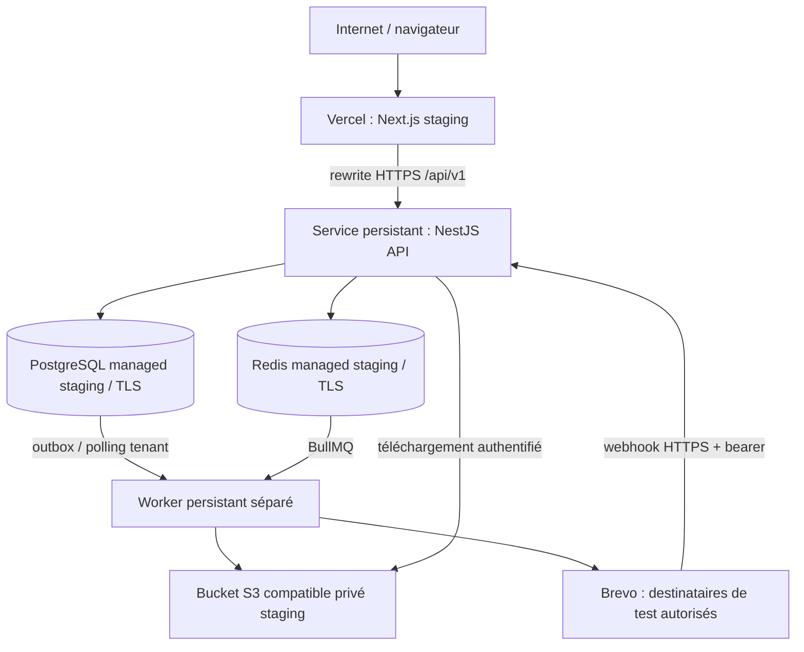

# LOT14 — Audit et architecture de staging

État au 24 octobre 2026 : préparation locale, **aucun staging distant déployé ou certifié**. Branche de travail : `feat/lot14-staging-certification`. Le propriétaire autorise les créations staging ci-dessous, dans les comptes GestSchool existants ou le workspace Render personnel, en région européenne commune si disponible. Les accès authentifiés ne sont pas encore actifs dans cette session. Aucun secret ne doit être fourni en chat.

| Ressource autorisée      | Nom / cible souhaités, pas une ressource créée                                     |
| ------------------------ | ---------------------------------------------------------------------------------- |
| Projet Vercel web        | `gestschool-v3-staging`, root `apps/web`                                           |
| Domaine Vercel           | `gestschool-v3-staging.vercel.app` si disponible, sinon domaine généré à rapporter |
| API Render               | `gestschool-v3-api-staging`                                                        |
| Worker Render            | `gestschool-v3-worker-staging`                                                     |
| PostgreSQL Render        | `gestschool-v3-postgres-staging`                                                   |
| Redis / Key Value Render | `gestschool-v3-redis-staging`                                                      |

Brevo : réutiliser le compte GestSchool/LOT11, ne pas créer un second compte. Le destinataire fourni est littéralement `<EMAIL_TEST>`, donc **MANUAL ACTION REQUIRED, aucun email réel autorisé tant qu'une vraie adresse contrôlée ne le remplace**. La création/configuration staging est autorisée ; ni production finale, ni remplacement/suppression V2, ni LOT15 ne le sont.

## Prérequis LOT13 acquis avant ce travail

PR [#61](https://github.com/BALLOPROTEL/GestSchool_V3/pull/61) fusionnée, commit de merge et main certifié : `9db48741b1559d6444e247432fa5336e0ad9adaa`. [CI main #25](https://github.com/BALLOPROTEL/GestSchool_V3/actions/runs/40125118997), événement push, `completed / success`, toutes les étapes en succès. Tag annoté `lot-13-go` publié sur ce commit ; objet tag `d941b6c5b1ac0065a2c6f161329cc78c5231d700`. Arbre main propre au checkpoint. `lot-12-go` est resté strictement inchangé : objet `cd4a0cc3fa810b06bfd6174fedcab6ecae9f51ff`, commit `5208841520f5e7e994a8a5f18c76573fbf4da9d8`.

L'audit s'appuie sur `security-production-checklist.md`, `security-hardening.md`, `lot13-certification.md` et les chargeurs de configuration, points d'entrée, contrôleurs de santé, adaptateurs S3, files et workers actuels. Le rapport historique LOT13 décrit sa certification locale initiale ; le checkpoint ci-dessus apporte la preuve post-merge distincte.

## Architecture proposée, ressources non provisionnées

Vercel héberge uniquement le web. L'API et le worker nécessitent des processus persistants : Render est une cible proposée, non un fournisseur déjà utilisé. PostgreSQL, Redis, stockage et clés sont dédiés au staging. Le compte, la région, les plans et leurs coûts doivent être confirmés avant provisionnement. Aucune ressource de production n'est créée.

Le navigateur utilise le même origin Vercel pour `/api/v1` : cela conserve les cookies host-only, `SameSite=Strict`, le CSRF et `connect-src 'self'`. Un accès navigateur direct Vercel → domaine Render distinct changerait cette topologie et doit être recertifié. Aucune ouverture wildcard de CORS ou cookies cross-site n'est prévue.

## Résultats de l'audit runtime

| Composant  | Constat / préparation                                                                                                                                                                                                                                                      | Preuve distante encore requise                                                                                                                                 |
| ---------- | -------------------------------------------------------------------------------------------------------------------------------------------------------------------------------------------------------------------------------------------------------------------------- | -------------------------------------------------------------------------------------------------------------------------------------------------------------- |
| Web        | Next 16.4.1, Node 24, pnpm 10.24.0, monorepo avec dépendances workspace ; root Vercel `apps/web`, accès aux fichiers hors root requis. Le garde-fou initial s'exécutait au `phase-production-server` dans `next.config.ts` ; il vérifie maintenant aussi le build hébergé. | Build Vercel réel, réécriture HTTPS, cookies transmis, domaines et certificat                                                                                  |
| API        | Écoute initialement fixée à loopback. `API_HOST=0.0.0.0` et le `PORT` fourni par le service sont maintenant configurables ; le défaut local reste loopback.                                                                                                                | Bind réseau, health/live et ready, chaîne proxy réellement observée                                                                                            |
| Worker     | Contexte Nest sans HTTP, documents/messaging/reports, fermeture via SIGTERM et `application.close()`, leases/retries/reconciliation existants.                                                                                                                             | Déploiement séparé, Chromium et librairies système, délais d'arrêt, absence de jobs perdus                                                                     |
| PostgreSQL | Prisma 7.10, `sslmode=verify-full` obligatoire en production. Seed DEV interdit en production.                                                                                                                                                                             | DB dédiée, CA valide, rôles migration/runtime, migrations deploy et bootstrap staging contrôlé                                                                 |
| Redis      | `rediss:` avec auth, quotas fail-closed, BullMQ node-redis. Les noms des trois queues ne dépendent pas du préfixe IAM.                                                                                                                                                     | Instance dédiée ; ne pas compter sur `IAM_REDIS_PREFIX` pour isoler les queues. Vérifier commandes BullMQ, persistance et noeviction                           |
| S3         | Endpoint HTTPS, clés tenant/UUID/checksum, bucket privé ; téléchargements par l'API, pas d'URL publique.                                                                                                                                                                   | ACL/policy, chiffrement, refus anonymes LIST/GET/PUT sur objet existant                                                                                        |
| Brevo      | Production exige email sender, WhatsApp sender, templates WhatsApp FR/EN/AR et secrets indépendants. Le webhook utilise un bearer, pas une signature du body.                                                                                                              | Compte et sender validés, templates réellement approuvés, destinataires autorisés, delivery + callback/replay                                                  |
| Proxy      | Seuls `direct` et `loopback` sont supportés. Une IP proxy privée distante n'est pas automatiquement fiable.                                                                                                                                                                | Topologie/CIDR fournisseur ; `direct` protège contre l'usurpation mais peut regrouper les quotas par proxy. Bloquant pour une certification d'IP client réelle |

Les quatre environnements sont explicites avec `APP_ENV=development|test|staging|production`. Si `APP_ENV` est fourni, les modes Node et IAM doivent correspondre ; staging utilise `NODE_ENV=production`, `IAM_ENV=staging`. Les commandes locales historiques sans `APP_ENV` restent compatibles. Sur Vercel, un build distant exige un `APP_ENV` distant explicite. Un simple changement de label ne provisionne ni n'isole les données : ressources, comptes et secrets distincts restent obligatoires.

## GitHub observé en lecture seule

- Dépôt public, main par défaut ; les permissions générales du compte incluent admin, mais la lecture du sous-endpoint de protection retourne `403 Resource not accessible by integration`. Cela ne prouve ni l'absence de protection classique ni un droit d'écriture de cette intégration.
- `GET /rules/branches/main` retourne `[]` : aucune règle de ruleset effective listée par cet endpoint.
- Private vulnerability reporting était désactivé lors de l'audit. Secret scanning n'est pas attesté (`security_and_analysis: null`).
- Dependabot est configuré pour npm et GitHub Actions, sans automerge. CODEOWNERS existe. Protection main, CI requise, blocage force-push et suppression, secret scanning et reporting privé doivent être vérifiés par le propriétaire dans les paramètres. Aucun réglage susceptible de bloquer le propriétaire n'a été changé.

## V2 et sources fournisseur

Lecture seule le 24 octobre 2026 de [gestschool.vercel.app](https://gestschool.vercel.app/) : titre « GestSchool - Al Manarat Islamiyat », page de connexion française. Aucun login, changement de projet/domaine, déploiement ou suppression. L'absence d'utilisateurs/données réelles à migrer est une donnée fournie par le propriétaire, pas une conclusion d'inspection de base V2.

Documentation consultée : [Vercel monorepos](https://vercel.com/docs/monorepos), [Render web services](https://render.com/docs/web-services), [Render background workers](https://render.com/docs/background-workers). Render exige notamment une écoute HTTP sur `0.0.0.0`. Les références ne constituent pas une preuve de déploiement GestSchool.

Le [runbook](deployment/staging.md), le [plan de cutover non exécuté](deployment/cutover-v2-v3.md) et le [rapport de certification](lot14-certification.md) détaillent les preuves et blocages. Aucun GO LOT14 ne peut être accordé sur les seuls tests locaux/CI.
