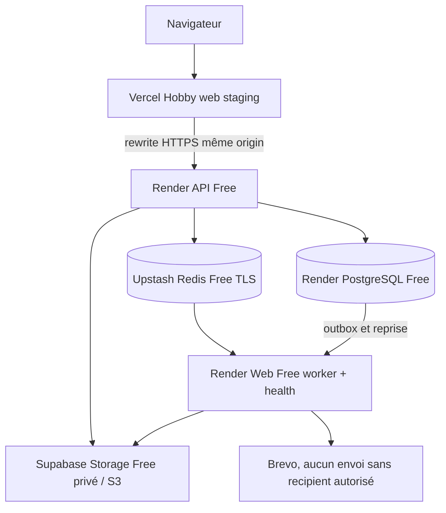

# LOT14 — Architecture de staging entièrement gratuite

Premier run Render du runner `8c2d09e` : **0 PASS / 14 FAIL / 0 SKIP**, worker E2E **SKIP**. La ligne `AUTH_UNAVAILABLE` du 26 octobre 2026 à 22:43:27 Europe/Paris reste sans route/statut attribuable ; ces compteurs ne prouvent pas 14 défauts RBAC indépendants. Voir le [diagnostic sûr et ses limites](lot14-auth-unavailable-diagnostic.md). `LOT14_CERTIFICATION_RUN=false` restauré par l'opérateur et non réactivé ici. Bootstrap A/B PASS et stabilité worker PASS restent acquis ; retry PostgreSQL existant mais non exercé sur la fenêtre stable, sans récupération revendiquée. **NO-GO LOT14 maintenu.**

## Historique des checkpoints antérieurs

**Reprise PostgreSQL : corrélation opérateur confirmée postgres down / Redis et Storage up. Classification sûre ajoutée ; timeouts et tentative unique conservés faute de preuve de timeout. Déploiement et fenêtre de stabilité bloqués par l'absence d'accès Render. Voir le [diagnostic et la suite conditionnelle](lot14-postgres-readiness.md). NO-GO maintenu.**

**Nouvelle exécution distante, 26 octobre 2026 à 18:58 CET : 49 PASS / 0 FAIL / 0 SKIP. NO-GO maintenu : deux readiness worker HTTP 503 reproduites. Tenant A/B et worker E2E non lancés ; aucun bootstrap disponible, confirmé par le propriétaire. Voir les [preuves et le diagnostic distinct PostgreSQL](lot14-remote-certification-2026-10-26.md). Les checkpoints ci-dessous sont historiques.**

Point de reprise du **26 octobre 2026, Europe/Paris** : **14 migrations appliquées et checksums vérifiés**, API readiness trois dépendances up, commandes normales restaurées, API live sur `b5a791f`, worker live sur `818ad43`. Worker : les trois runtimes et readiness ont réussi après migration, un réveil a échoué avec ConnectionTimeoutError Redis ; le nouveau déploiement a une readiness PASS après un échec PostgreSQL ponctuel, stabilité non certifiée. **Vercel staging READY**, pages FR/EN/AR accessibles ; 49 smoke en attente de l'accès réseau de l'environnement de test. **NO-GO LOT14**, quatre documents non committés.

Décision du 25 octobre 2026 : **zéro paiement et zéro carte avant validation client**. Cloudflare R2 est abandonné ; Supabase Storage Free est choisi. Les limites gratuites ci-dessous sont acceptées pour staging uniquement. Verdict actuel **NO-GO**, car les parcours applicatifs distants restent à certifier ; le stockage S3 est PASS réel.

| Composant  | Cible et état réel                                                                                                                                                            |
| ---------- | ----------------------------------------------------------------------------------------------------------------------------------------------------------------------------- |
| Web        | Vercel Hobby dédié READY sur b5a791f ; https://gestschool-v3-staging.vercel.app ; navigateur distant à certifier                                                              |
| API        | Render Free Francfort, b5a791f live, commande normale et /health/ready : postgres/redis/storage up                                                                            |
| PostgreSQL | Render Free `dpg-dbei7tqvcj2c73d1qukg-a`, PG 18 à Francfort, disponible selon provider, expiration `2026-11-23T21:32:39Z`                                                     |
| Redis      | Upstash Free rediss/6379 ; DNS/TCP/TLS/AUTH/PING historiquement PASS sur les deux services ; timeout au réveil worker à diagnostiquer                                         |
| Worker     | Render Web Service Free ; trois runtimes et readiness initialement PASS, puis nouvelle instance en échec ConnectionTimeoutError / HTTP 503                                    |
| Storage    | Supabase Free `gestschool-v3-staging`, `rwmuksaafbnphurxaofq`, région réelle **eu-west-1** (projet existant réutilisé), bucket `gestschool-v3-staging-private` confirmé privé |
| Brevo      | Compte PROTEL existant, aucun destinataire autorisé et aucun email réel                                                                                                       |

Le navigateur conserve l'origin Vercel pour `/api/v1`, les cookies host-only/Strict, le CSRF et connect-src self. Aucune ouverture wildcard. Les origins doivent rester les deux adresses staging réelles ; aucune mutation V2.

L'adaptateur S3 reste inchangé. Endpoint configuré `https://rwmuksaafbnphurxaofq.storage.supabase.co/storage/v1/s3`, région `eu-west-1`, path-style true. Les deux clés S3 et REDIS_URL ne sont pas lues par l'agent ; elles restent dans Render. Diagnostic temporaire `LOT14_STORAGE_PROBE=true` au build API préparé pour vérifier les quatre opérations S3, checksum/MIME, refus anonymes et suppression, sans clé dans les logs. Le hook doit être publié sur la branche avant toute exécution réelle.

Le worker n'ouvre HTTP que si `WORKER_HTTP_HEALTH_ENABLED=true`, APP_ENV staging et NODE_ENV production ; port Render, 200/503, pas de données métier. L'image inclut Chromium, ses librairies et les fontes du lockfile. Le port est ouvert après les trois runtimes, puis fermé avant arrêt des queues. Pas de serveur health factice indépendant d'un worker prêt.

## Limites acceptées pour staging uniquement

Supabase Free : 1 GB, fichier maximum 50 MB, pause après inactivité, aucune garantie production/HA. Bucket public=false confirmé ; limite bucket null héritant du plafond global Free. Clés serveur S3 à portée projet et contournant RLS : isolation d'un projet V3 dédié essentielle.

Render Web Free : sommeil après 15 minutes d'inactivité, réveil lent, redémarrages, 750 heures partagées/mois. Les jobs Redis n'éveillent pas automatiquement le worker : réveil manuel avant certification. Filesystem éphémère, aucun document local comme fallback. PostgreSQL Free : temporaire 30 jours, 1 GB, sans backup fournisseur ; aucune donnée réelle. Upstash Free : quotas et polling BullMQ à surveiller ; pas d'upgrade ni pay-as-you-go.

## État de revue

Bucket confirmé privé, paramètres S3 publics enregistrés dans Render ; clés/Redis signalés configurés par le propriétaire. Sonde S3 et health worker testées localement, image validée (PDF FR/AR hors ligne non root sous 512 Mo) et recertification complète réussie : sécurité 187, unités 502, IAM/métiers 358, Reports 13, Messaging frais, E2E 114 PASS / 89 skips / 0 FAIL. Les quatre opérations S3 signées et refus anonymes sont maintenant PASS réels. Migrations/seed et 49 smoke restent non exécutés à distance. Les résultats détaillés et 45 points sont dans `lot14-certification.md`, la procédure dans `deployment/staging.md`.

Les limites gratuites acceptées ne constituent plus un motif de NO-GO à elles seules ; les preuves applicatives manquantes restent bloquantes. Les 15 fichiers ont été publiés après autorisation explicite dans le WIP `dcb707ff6abdd72bf23941e030369799eddc7924` ; seules les mises à jour documentaires après exécution restent non committées pour revue. Aucun merge, tag LOT14, paiement, carte, production finale ou LOT15. V2 Vercel et Supabase intacts. LOT13 reste acquis sur `9db48741b1559d6444e247432fa5336e0ad9adaa` / `lot-13-go`.

## Checkpoint réel après publication du WIP

Source publiée après autorisation : `dcb707ff6abdd72bf23941e030369799eddc7924`. **Supabase S3 PASS réel**, observé dans les logs applicatifs API du déploiement `dep-dbf6o684cbqc73dstdr0` le 25 octobre 2026 à 21:55:31–33 Europe/Paris : HeadBucket, PutObject, GetObject/checksum/MIME, DeleteObject/disparition, GET/LIST/PUT S3 anonymes refusés, objet inchangé et route publique Supabase refusée. Bucket toujours privé, zéro objet après nettoyage. Preuves détaillées dans le rapport de certification. Adaptateur S3 inchangé, secrets uniquement dans Render.

Le diagnostic a été exécuté temporairement au démarrage API pour rendre ses événements lisibles via la connexion de logs. Commande normale `node apps/api/dist/main.js` maintenant restaurée et vérifiée ; flag de build LOT14_STORAGE_PROBE=false.

Worker Web Service Free créé : `srv-dbf6hbq9lscs738vvea0`, `https://gestschool-v3-worker-staging.onrender.com`, Docker / Francfort / branche LOT14, sonde `/health/ready` enregistrée. Le propriétaire a confirmé sslmode=verify-full dans les deux DATABASE_URL. Le dernier worker reste en échec `WORKER_STARTUP_FAILED` après ce réglage ; le propriétaire identifie un `ConnectionTimeoutError` Redis TLS ; la configuration IAM API est chargée et la clé messaging est configurée ; le correctif API est live, mais sa readiness reste HTTP 503. Aucun TLS affaibli ni faux health. Les parcours applicatifs et les 49 smoke restent non certifiés : **NO-GO LOT14**, indépendamment du succès S3.

Aucun paiement ou carte, merge, tag GO, production finale, LOT15 ou modification V2. Les mises à jour documentaires post-exécution restent non committées pour revue.

### État actuel — migrations appliquées, Vercel prêt, réveil worker à diagnostiquer

HEAD publié : `818ad4325e0e7d154c4799b536a5355b36c5fd68`, branche `feat/lot14-staging-certification`. Les quatre documents restent hors commit. Correctif email seul `0cbd8d9`, CLI Redis `4f561bc`, préflight worker `b4fa1d6`, lanceur de migration `b5a791f`, diagnostic sûr des dépendances `818ad43`.

**Migrations PASS réel** : API `dep-dbf9pilg1s2s73f0a8b0`, événement du 26 octobre à 01:22:54 CET (00:22:54Z), LOT14_MIGRATIONS / PASS / applied=14 / checksumsVerified=true. Les 14 migrations historiques et leurs checksums sont conservés ; aucun reset ni seed. Le lanceur refuse une autre base, origine, environnement, manifeste SQL ou absence du flag --apply. Prisma utilise require/strict dans son seul sous-processus, vérification finale pg et applications verify-full. Les quatre tests TLS locaux, dont CA inconnue et mauvais hostname refusés, sont PASS.

**Commandes normales restaurées et vérifiées** après confirmation du propriétaire : API Start Command `node apps/api/dist/main.js`, worker Docker Command vide. Les deux sondes fournisseur sont `/health/ready`, aucun hook de migration ou probe au démarrage normal. Flag de build S3 LOT14_STORAGE_PROBE=false. API normale `dep-dbf9t90m7kps738a2q70`, live sur b5a791f ; lecture publique réelle : postgres/redis/storage up, status ok.

**Worker initial PASS réel puis régression au réveil** : `dep-dbf9ptlg1s2s73f0b7jg`, live sur b5a791f, instance bmvq7. Le 26 octobre à 01:24:40–50 CET, les trois marqueurs Documents, Messaging et Reports ready, les trois dépendances up et « GestSchool worker is ready » sont observés. `/health/ready` a répondu status ok. À partir de 01:45:39 CET, nouvelle instance wvw4f : ConnectionTimeoutError du client @redis/client puis WORKER_STARTUP_FAILED, avant tout runtime ready ; les nouvelles requêtes publiques live/ready répondent 503. La même nouvelle instance wvw4f a finalement redémarré les trois runtimes et annoncé dependencies up / worker ready à 01:48:40–50 CET. Une lecture publique ultérieure de /health/live est status ok, mais /health/ready reste observée à 503. Le succès initial ou la reprise ne certifient donc pas une readiness stable après veille. Aucun health factice, timeout augmenté à l'aveugle, client remplacé ou TLS affaibli.

PostgreSQL externe verify-full fonctionne depuis API et a fonctionné depuis worker. Allowlist propre à la base exactement **74.220.51.0/24** et **74.220.59.0/24** ; règle Workspace globale inchangée. Le premier préflight worker avant migration avait correctement constaté cinq tables absentes ; ce constat historique est remplacé par les 14 migrations vérifiées et le démarrage des runtimes. Redis DNS/TCP/TLS/AUTH/PING avait réussi sur API et worker, même empreinte `13d2bc5311dc`, rediss/6379 ; cette preuve historique ne garantit pas le réveil ultérieur. S3 privé conserve sa certification réelle signée/anonyme et son nettoyage. Credentials exclusivement dans Render.

**Vercel staging READY** : compte Hobby `PROTEL's projects`, projet dédié `prj_3UdsP3bidz7SrLfkogJC7VqPrxU8`, déploiement `dpl_BQU8zCpKaGRJyRYLS3BrakGsy7hj` sur le SHA b5a791f. URL stable `https://gestschool-v3-staging.vercel.app`, root apps/web, Node 24, dépendances workspace incluses, fonctions fra1. L'échec précédent venait d'APP_ENV absent des builds Preview ; APP_ENV=staging, IAM_ENV=staging, NODE_ENV=production et les deux origines publiques exactes sont configurés sur ce seul projet, en Preview et Production Vercel. Production désigne ici l'alias stable du projet staging ; aucune production officielle ni bascule V2. Aucun secret backend dans le web. Pages FR/EN/AR servies ; requête de contrôle login HTTP 200, CSP sans unsafe-eval, no-store, HSTS et nosniff observés. La route réécrite /api/v1/auth/csrf répond HTTP 200. La réponse CSRF et son cookie ont été contrôlés sans afficher leurs valeurs : __Host-gs_csrf, Secure, HttpOnly, SameSite=Strict, Path=/, sans Domain ; réponse no-store/nosniff. Cela ne remplace pas la validation navigateur de l'hydratation ou de l'authentification.

**49 smoke : NOT RUN**. Le proxy de l'environnement local refuse CONNECT vers les trois domaines staging (403). Le propriétaire confirme les trois hôtes ajoutés, mais la révision active 46 ne les contient pas et CONNECT reste refusé ; vérification de l'enregistrement dans cette session demandée. Aucun contournement du proxy. Playwright --list découvre bien 49 tests, avec le proxy de l'environnement conservé et ignoreHTTPSErrors=false ; aucun test distant exécuté ou résultat de navigateur distant revendiqué. Les parcours Tenant A/B, auth/MFA/RBAC/isolation et worker document PDF/report/téléchargement privé restent NOT RUN ; seed DEV toujours interdit en staging, bootstrap contrôlé encore requis.

Recertification du HEAD publié : 14 étapes PASS ; sécurité **235**, unités **531**, IAM **358**, Reports **13**, Messaging intégré sur DB locale neuve isolée PASS, CLI **19** tests inclus dans la sécurité, audit/typecheck/lint/format/build/bundle/diff verts. Référence navigateur locale inchangée 0cbd8d9 : **114 PASS / 89 skips contractuels / 0 FAIL**, pas de nouvelle assertion affaiblie.

Diagnostic worker `818ad43` publié et poussé après les 14 vérifications vertes : uniquement des états fixes postgres/redis/storage up/down sont journalisés en cas de dépendance indisponible, jamais l'erreur brute ni la configuration. Quatre tests couvrent le succès et chaque dépendance en défaut, sans rendre ready un worker indisponible. Déploiement normal `dep-dbfaattg1s2s73f1u7i0` **live** sur 818ad43, instance wm6qz ; commande Docker toujours vide, sonde /health/ready. Trois runtimes ready et dépendances up observés le 26 octobre à 02:01:10–19 CET (01:01:10–19Z), puis diagnostic à 02:01:27 CET : **postgres=down, redis=up, storage=up**. Une nouvelle lecture publique réelle de /health/ready répond ensuite status ok, API également postgres/redis/storage up. La cause du défaut PostgreSQL ponctuel reste à mesurer ; aucune panne Redis n'est déduite de ce dernier résultat. Aucun timeout, client, adaptateur, validation ou architecture changé.

Verdict **NO-GO LOT14** : readiness worker intermittente et certification distante applicative incomplète. **MANUAL ACTION REQUIRED — Brevo test recipient** ; aucun email réel. Limites Free acceptées uniquement pour staging : Supabase 1 GB, fichier 50 MB, pause après inactivité et sans HA ; services Render pouvant dormir ; PostgreSQL Free temporaire. Aucun paiement, carte, merge, tag GO, changement V2, production finale ou LOT15.
