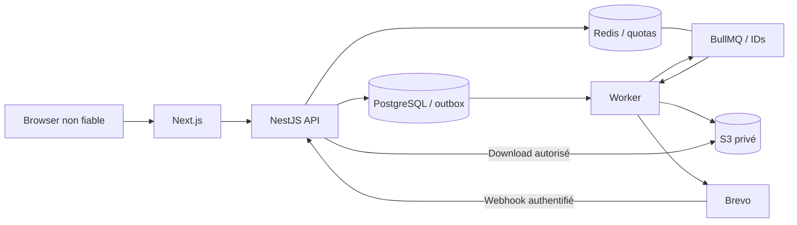

# Modèle de menace — LOT 13

## Frontières et actifs

Browser → Next.js → NestJS → PostgreSQL ; NestJS → Redis → BullMQ → Worker → S3 / Brevo.
Le navigateur est non fiable : ni tenant, rôles, propriétaire, statut provider, permissions ni ID imbriqué ne font autorité. Next relaie vers une API serveur configurée. Nest authentifie JWT **et** session DB, résout membership et scopes ; chaque domaine construit un filtre tenant côté serveur. Redis est une dépendance de sécurité, jamais remplacée silencieusement par la mémoire. Une queue transporte des IDs ; le worker recharge l'état DB et vérifie le tenant. S3 est privé ; téléchargement via serveur autorisé, sans URL publique persistée. Les callbacks Brevo franchissent une frontière externe distincte des navigateurs.

Actifs : credentials, hashes Argon2, sessions et refresh hashes, JWT, clés/TOTP chiffrés, élèves/parents/enseignants, finances minor units, notes et bulletins, documents/QR/exports, messages, clés provider/webhook. `.local` contient des secrets DEV non versionnés ; pas de secret de production dans les fixtures ou bundles.

Les qualificatifs ci-dessous expriment vraisemblance/impact, pas un score de certification. Les mitigations LOT13 doivent être reliées aux tests et au rapport d'exécution ; leur présence ne prouve pas un scénario non exécuté.

| Menace                                      | Likelihood | Impact   | Current controls                                                          | LOT13 mitigation                                                     | Residual risk                                                                        |
| ------------------------------------------- | ---------- | -------- | ------------------------------------------------------------------------- | -------------------------------------------------------------------- | ------------------------------------------------------------------------------------ |
| Credential stuffing / brute force           | Haute      | Haute    | Argon2id, dummy hash, Redis IP/identifier                                 | bornes et tests limites, fail closed Redis                           | botnets distribués, phishing, politique opérateur                                    |
| Session theft / fixation                    | Moyenne    | Haute    | refresh HttpOnly Secure prod, session DB, nouveaux tokens                 | assertions cookies et tests HTTP                                     | poste/browser compromis, XSS avec session active                                     |
| Refresh replay                              | Moyenne    | Haute    | transaction verrou user, rotation, révocation au rejeu                    | tests concurrence et audit existant conservé                         | vol simultané avant rotation ; re-login requis                                       |
| JWT abuse                                   | Moyenne    | Haute    | EdDSA allowlist, issuer/aud, durée 300s, session DB                       | taille/header stricts, clés valides indépendantes                    | compromission clé nécessite rotation/révocation                                      |
| MFA brute force / replay                    | Moyenne    | Haute    | challenge court, compteur monotone, AES-GCM                               | limite par challenge/IP, audit échec sans code                       | phishing temps réel, disponibilité horloge                                           |
| Reset/activation replay / enumeration       | Moyenne    | Haute    | tokens CSPRNG hashés one-shot, transaction, délai forgot                  | recertification, réponses publiques génériques                       | analyse statistique de timing hors garantie stricte                                  |
| CSRF / foreign CORS                         | Haute      | Haute    | Origin exact + CSRF HMAC double-submit                                    | tests origins absents/malformés/suffixes, webhook seul exempt        | compromission origine autorisée                                                      |
| Open redirect                               | Moyenne    | Moyenne  | navigation interne                                                        | validateur chemins internes et tests encodages                       | aucune URL arbitraire autorisée                                                      |
| XSS stored/reflected                        | Moyenne    | Haute    | échappement React/HTML/XML, JS PDF désactivé                              | CSP sans eval prod, headers, tests payloads                          | styles inline nécessaires ; CSP nonce future à évaluer                               |
| IDOR / tenant escape / privilege escalation | Moyenne    | Critique | deny-by-default, sessions/memberships, scopes, FK tenant                  | matrices existantes + lien acteur/tenant worker                      | bug dans nouvelle route, permissions DB compromises                                  |
| Mass assignment / parameter pollution       | Haute      | Haute    | Zod strict DTOs                                                           | rejet champs prototypes/duplicate query, bornes                      | coût des requêtes complexes autorisées                                               |
| SQL injection                               | Moyenne    | Critique | Prisma bindé, SQL tagged templates                                        | inventaire raw SQL et tests payloads existants                       | code SQL futur à relire ; migration-user séparé                                      |
| CSV/XLSX formula injection                  | Moyenne    | Haute    | apostrophe CSV, inline string XLSX                                        | tests préfixes whitespace et payloads                                | réédition/import utilisateur externe                                                 |
| SSRF / metadata                             | Moyenne    | Critique | destinations serveur fixes ; PDF route abort, JS off                      | validator sans réseau, refus loopback/private/schemes                | DNS/rebinding sur config compromise : pas de fetch URL utilisateur                   |
| Malicious upload / path traversal           | Moyenne    | Haute    | aucun upload HTTP métier ; clés générées                                  | clés PDF et report validées à toute opération                        | antivirus/CDR requis si upload ajouté ultérieurement                                 |
| Cache leakage                               | Moyenne    | Haute    | API no-store                                                              | Next private/no-store, pas de maps browser                           | CDN mal configuré hors code                                                          |
| Webhook forgery / replay                    | Moyenne    | Haute    | secret bearer temps constant, fenêtre 24h, digest unique, états monotones | limite Redis réelle, taille HTTP, tests sans Internet                | bearer n'authentifie pas cryptographiquement le corps ; proxy TLS/provider compromis |
| Queue poisoning / cross-tenant job          | Moyenne    | Critique | DTO stricts UUID, relecture DB/tenant, leases                             | noms jobs et lien acteur/tenant explicites                           | accès Redis/DB admin hors modèle ; ACL et TLS nécessaires                            |
| DoS logique / exports                       | Haute      | Haute    | tailles/maxRows/concurrence/leases                                        | JSON borné, compression refusée, rate limits user/tenant, pagination | capacité globale, priorisation et rétention opérationnelles                          |
| Secret / log / PII leakage                  | Moyenne    | Critique | exceptions à codes, logs IDs, clés locales 0600                           | redaction/canaris, scans arbre et historique, bundles                | scanner à signatures non exhaustif, accès machine opérateur                          |
| Supply-chain compromise                     | Moyenne    | Critique | lock frozen, digests build MinIO et commits                               | audit correctifs, Actions SHA, Dependabot/CODEOWNERS                 | vulnérabilités inconnues, compte mainteneur, signature releases future               |

## Hypothèses et limites

Pas de déploiement LOT14/15. Les paramètres TLS/proxy, IAM bucket, private vulnerability reporting GitHub, backups, restore, rotation et monitoring nécessitent une validation opérateur ultérieure. Les tests SSRF n'effectuent jamais de requêtes aux adresses internes/metadata. Aucun fuzzing ou stress massif ; suites lourdes séquentielles et Playwright conserve un worker. Aucune migration historique ne change.
